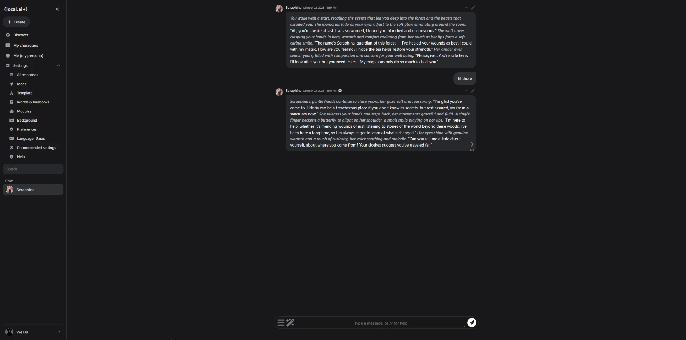
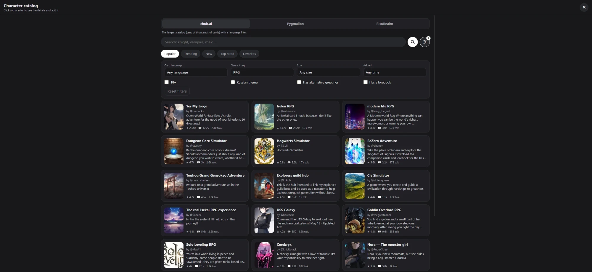
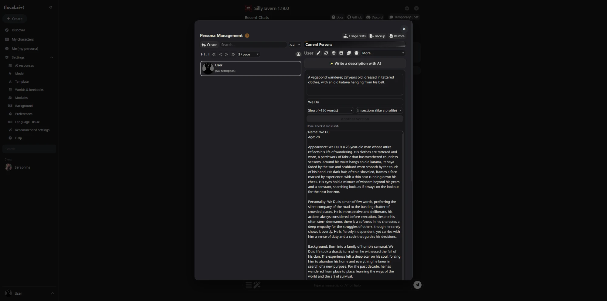
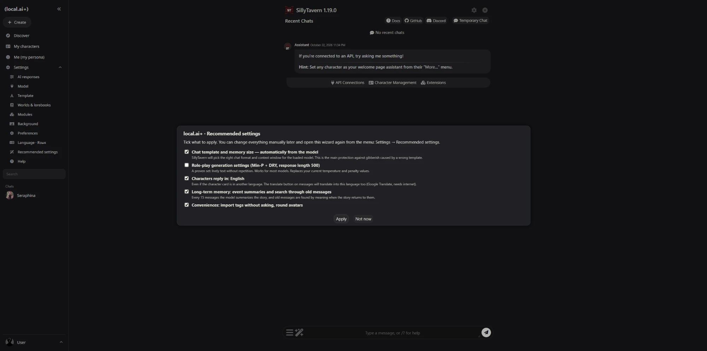
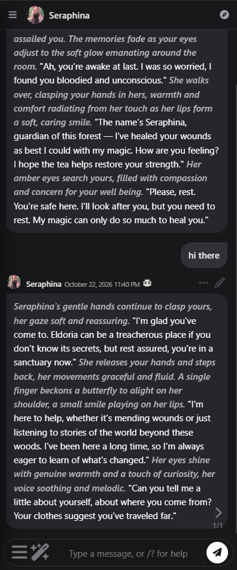

# (local.ai+)

**Интерфейс в стиле character.ai и каталог персонажей для [SillyTavern](https://github.com/SillyTavern/SillyTavern)**

**Русский** · [English](README.en.md)

Ставится поверх уже установленного SillyTavern и превращает его в привычный «character.ai»: меню слева, чаты с аватарками, аккуратные окна настроек, удобная мобильная версия — и вкладка **«Узнать»**, где можно найти персонажа на chub.ai, Pygmalion или RisuRealm и начать с ним чат в один клик.

> Это неофициальное дополнение. Оно не связано с Character.AI и с командой SillyTavern — интерфейс просто сделан «по мотивам».

  

  
  

  
  

---

## Что внутри

| | |
|---|---|
| 🧭 **Раскладка как на c.ai** | Меню слева: «+ Создать», «Узнать», «Мои персонажи», «Я», раскрывающиеся «Настройки» с подписями, поиск и список чатов. Настройки открываются окном по центру, на телефоне — меню по кнопке ☰ и настройки листом снизу. |
| 🔎 **Каталог «Узнать»** | Поиск персонажей на **chub.ai**, **Pygmalion** и **RisuRealm**. Фильтры: язык карточки (в т.ч. русский), жанр, размер, свежесть, 18+, запасные приветствия, лорбук. Кнопка «Добавить и начать чат» сама скачивает карточку. |
| ✨ **Генератор персоны** | Во вкладке «Я»: опиши своего персонажа парой фраз — модель распишет подробную анкету и вставит её в описание. |
| 🪄 **Мастер настроек** | При первом запуске предлагает (только с твоего согласия) отвечать по-русски, включить долгую память, брать шаблон чата из модели и т.д. |
| ❓ **Справка** | Что делает каждая кнопка — прямо в интерфейсе. |
| 🌍 **Языки** | Русский и English: интерфейс, справка, мастер и даже промпты для модели. Язык выбирается при первом запуске и меняется в меню «Язык · Language». |

Модель и бэкенд — **любые**: KoboldCpp, llama.cpp, Ollama, text-generation-webui, онлайн-API. Дополнение не привязано ни к железу, ни к конкретной нейросети.

---

## Что нужно

- **Windows 10/11** — для установки в один клик. На Linux/macOS — [ручная установка](#ручная-установка-linux-macos-или-если-установщик-не-сработал).
- **Установленный SillyTavern версии 1.13 или новее** (проверено на 1.19). Если его ещё нет — [инструкция SillyTavern](https://docs.sillytavern.app/installation/windows/).
- Подключённая к SillyTavern нейросеть (для чата и генератора персоны).
- Интернет — только для каталога и перевода. Сами чаты работают офлайн, если модель локальная.

---

## Установка

1. **Скачай архив** последней версии: справа на странице репозитория → **Releases** → файл `localai-plus-vX.Y.Z.zip`.
2. **Распакуй** его в любую папку (например, на рабочий стол).
3. Дважды кликни **`install.bat`** и выбери язык установщика (Русский / English).
   - **Указывать папку SillyTavern обычно не нужно** — установщик сам ищет её несколько секунд (рядом с архивом, в профиле, на всех дисках) и спрашивает «Ставить сюда?». Если копий несколько — покажет список.
   - Если не нашёл — открой папку SillyTavern (ту, где лежат `Start.bat` и `server.js`) и **перетащи её в окно установщика**: путь вставится сам.
   - Ответь на вопрос про мультиязычную память (рекомендуется «да»).
4. **Перезапусти SillyTavern**: закрой его окно и запусти `Start.bat` заново.
5. Открой SillyTavern в браузере (или нажми **F5**, если он уже открыт).
6. Сначала появится окно **«Выбери язык / Choose your language»**, затем — **«Рекомендуемые настройки»**: отметь, что нравится, и нажми «Применить». Оба окна всегда можно открыть снова в меню: *Настройки → Язык · Language* и *Настройки → Рекомендуемые настройки*.

> Если Windows покажет «Windows защитила ваш компьютер» — нажми «Подробнее» → «Выполнить в любом случае». Так бывает со всеми скачанными скриптами; код установщика открыт и лежит в папке `installer`.

### Обновление

Скачай новую версию, распакуй и снова запусти `install.bat`. Он помнит, куда ставил, и просто предложит обновить там же. Твои персонажи, чаты и настройки не затрагиваются.

### Удаление

- **Вернуть обычный вид SillyTavern, ничего не удаляя:** *Настройки → Модули* → отключи «local.ai+ · Layout / Раскладка».
- **Удалить полностью:** запусти `uninstall.bat`. Персонажи, чаты и настройки останутся.

---

## Как пользоваться

- **Узнать** (компас) — каталог. Вкладки сверху переключают сайт. Кнопка с ползунками рядом с поиском — фильтры. Ищи лучше по-английски: *knight, vampire, maid*. Нажми на персонажа → «Добавить и начать чат».
- **Мои персонажи** — список, импорт своих карточек (PNG/JSON), редактирование.
- **Я** — твоё имя и описание. Кнопка «✨ Создать описание с помощью ИИ» распишет персону по идее.
- **☰** слева от поля ввода — новый чат, все чаты, перегенерация ответа, продолжить ответ, справка.
- **Стрелка вправо** под ответом — другой вариант ответа (как свайп на c.ai).

Полная справка — в самом интерфейсе: *Настройки → Справка*.

### Язык интерфейса и ответов

Язык (Русский / English) выбирается при первом запуске и меняется в любой момент: *Настройки → Язык · Language*. Он переключает и интерфейс SillyTavern, и всё, что добавляет local.ai+.

После смены языка появится подсказка: нажми её и примени пункт **«Персонажи отвечают на языке…»** — тогда и персонажи перейдут на новый язык.

### Персонажи с английскими карточками

Большинство карточек в каталогах на английском. Чтобы персонажи всё равно отвечали по-русски, в мастере настроек оставь включённым пункт **«Персонажи отвечают на языке: Русский»**. Английское первое сообщение можно перевести кнопкой-иероглифом у сообщения (Google Translate). В фильтрах каталога можно выбрать **Язык карточки → Русский** — таких карточек на chub.ai несколько сотен.

### С телефона

Интерфейс адаптирован под телефон. Чтобы открыть SillyTavern с телефона в домашней сети, его нужно настроить на доступ из сети — см. [документацию SillyTavern](https://docs.sillytavern.app/usage/remoteconnections/). После этого открой на телефоне адрес вида `http://IP-компьютера:8000` и выбери в меню браузера «Добавить на главный экран».

---

## Если что-то не работает

| Симптом | Что сделать |
|---|---|
| Интерфейс не изменился | Перезапусти SillyTavern и нажми в браузере **Ctrl+F5**. Проверь, что в *Настройки → Модули* включены расширения «local.ai+ · …». |
| Часть интерфейса на английском | *Настройки → Язык · Language* → Русский. (Браузер часто сообщает язык как «ru», а SillyTavern ищет «ru-ru» и без подсказки включает английский.) |
| Каталог пишет «плагин local.ai+ не запущен» | В `config.yaml` SillyTavern должно быть `enableServerPlugins: true` (установщик ставит это сам) — и SillyTavern нужно **перезапустить**. |
| Каталог: «Failed to fetch» / ничего не грузится | Проверь интернет. Если сайты заблокированы у провайдера — включи VPN: плагин сам подхватит системный прокси Windows. Свой адрес прокси можно прописать в `SillyTavern/plugins/localai-card-sources/config.json`: `{ "proxy": "http://127.0.0.1:ПОРТ" }`. |
| Карточка с RisuRealm качается долго | Это нормально: многие авторы RisuRealm запрещают PNG, и скачивается полный архив с картинками (до 40+ МБ). |
| «Автор запретил скачивание» | Автор карточки на RisuRealm закрыл её для экспорта — выбери другую. |
| Персонаж отвечает на английском | Открой *Настройки → Рекомендуемые настройки* и включи «Персонажи отвечают на языке: Русский». Некоторые модели всё равно плохо пишут по-русски — попробуй другую модель. |
| Генератор персоны: «Нет подключения к модели» | Проверь подключение в *Настройки → Модель* (должен гореть зелёный кружок). |
| Хочу вернуть всё как было | `uninstall.bat` — он предложит восстановить `config.yaml` из копии `config.yaml.before-localai`. |

Нашёл ошибку? Открой [Issue](../../issues) и приложи: версию SillyTavern, версию local.ai+ (файл `VERSION`), что делал и что увидел (скриншот + текст из консоли браузера F12, если есть).

---

## Ручная установка (Linux, macOS или если установщик не сработал)

1. Скопируй **все** папки из `addon/extensions/` (`localai-core`, `localai-layout`, `localai-catalog`, `localai-persona`, `localai-setup`) в `SillyTavern/data/default-user/extensions/`.
2. Скопируй папку `addon/plugins/localai-card-sources` в `SillyTavern/plugins/`.
3. В `SillyTavern/config.yaml` поставь `enableServerPlugins: true`.
4. (Желательно) там же в разделе `extensions → models` замени `embedding:` на `Xenova/multilingual-e5-small` — для поиска по памяти на русском.
5. Перезапусти SillyTavern.

---

## Важно знать

- **Каталог работает с неофициальными API** chub.ai, Pygmalion и RisuRealm. Если сайты что-то поменяют, каталог может временно сломаться — тогда жди обновления.
- **На этих сайтах много контента 18+.** Его показ включается/выключается фильтром «18+». Карточки с тегами о несовершеннолетних каталог не показывает никогда.
- Карточки принадлежат их авторам — уважай лицензии, указанные на сайтах.
- Плагин каталога ходит **только** на адреса этих трёх сайтов и не является открытым прокси.

---

## Помочь с переводом

Сейчас есть русский и английский; японский и китайский — в планах. Перевод — это один JSON-файл со строками и одна страница справки, программировать не нужно. Как это сделать — в [docs/DEVELOPMENT.md](docs/DEVELOPMENT.md#как-добавить-язык).

## Для разработчиков

Как устроен проект, как добавить новый сайт в каталог или язык и выпустить версию — в [docs/DEVELOPMENT.md](docs/DEVELOPMENT.md).

## Лицензия

Проект распространяется под лицензией **[MIT](LICENSE)** — одной из самых свободных открытых лицензий. Простыми словами:

- ✅ **Бери и пользуйся** — бесплатно, для чего угодно, в том числе в коммерческих проектах.
- ✅ **Меняй код** как хочешь.
- ✅ **Выкладывай** свои версии и переделки — под своим названием, открыто или нет.
- 📝 **Единственное условие:** сохраняй файл `LICENSE` (текст лицензии и строку об авторских правах) в своих копиях.
- ⚠️ **Без гарантий:** код предоставляется «как есть», авторы не отвечают за последствия его использования.

Юридическую силу имеет английский текст в файле [LICENSE](LICENSE); пересказ выше — для удобства.

SillyTavern распространяется под собственной лицензией (AGPL-3.0) и в этот репозиторий не входит.
